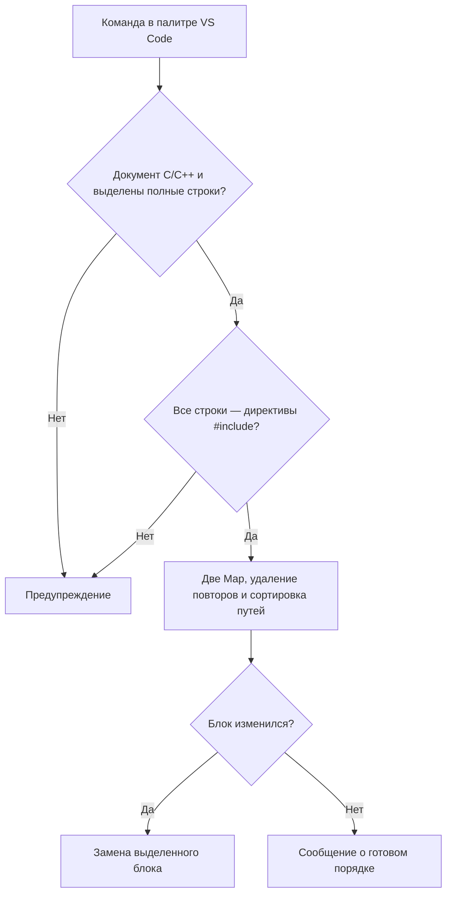

# Техническое задание и архитектура

## Техническое задание

1. Разработать для Visual Studio Code расширение на JavaScript с командой **C/C++: Sort Selected Includes**.
2. Принимать одно непустое выделение из полных строк в активном документе с языком C или C++. Каждая строка должна содержать директиву `#include <имя>` или `#include "имя"`, с допустимыми пробелами и табуляцией вокруг элементов директивы.
3. Вывести сначала директивы с угловыми скобками, затем с кавычками. В каждой группе отсортировать пути заголовков лексикографически с учётом регистра.
4. Оставить первую строку для каждой пары «вид кавычек, путь заголовка». При замене сохранить формат перевода строк документа и текст за пределами блока.
5. При ошибке выделения вывести предупреждение. Если выделенный блок уже упорядочен, сообщить об этом. В обоих случаях оставить текст без изменений.

## Компоненты

| Файл | Ответственность |
|---|---|
| `package.json` | Описывает расширение, точку входа, минимальную версию VS Code и команду. |
| `src/extension.js` | Регистрирует команду, получает выделение, проверяет границы строк и применяет правку редактора. |
| `src/sort-includes.js` | Разбирает строки, группирует заголовки, удаляет повторы и сортирует результат. |
| `.vscode/launch.json` | Запускает окно разработки расширений для отладки по F5. |

Алгоритм хранит две структуры `Map`: для `<...>` и для `"..."`. Ключ — путь заголовка, значение — исходная строка. Перед вставкой проверяется наличие ключа, поэтому при дубле остаётся первая строка. Затем ключи каждой группы сортируются, и по ним собирается результат.

## API Visual Studio Code

VS Code читает описание команды из `contributes.commands` в манифесте. При первом запуске команды процесс Extension Host загружает модуль из поля `main` и вызывает `activate`. Модуль связывает идентификатор команды с обработчиком через `vscode.commands.registerCommand`. Обработчик читает документ и выделение через `vscode.window.activeTextEditor` и применяет замену через `TextEditor.edit`.

[Extension Anatomy — документация VS Code](https://code.visualstudio.com/api/get-started/extension-anatomy)

## Границы применения

Команда предназначена для выделенного блока обычных директив, порядок которых можно менять. Решение не анализирует зависимости между заголовками, состояние препроцессора и контекст многострочного комментария. Для таких случаев выбор подходящего блока остаётся за пользователем.
